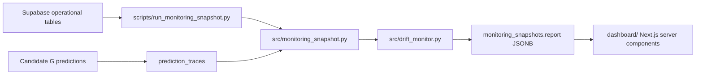

# Monitoring Architecture

Pulso TransMi monitoring has one canonical metrics path:

## Data sources

The snapshot is reconstructed from existing tables: `observations`, `forecast_cycles`, `forecast_cycle_targets`, `predictions`, `submission_receipts`, `model_versions`, `pipeline_runs`, `data_quality_checks`, `stream_cursors`, and `runtime_ingestion_events`.

Two observability-only tables were added:

- `prediction_traces`: Candidate G calibration trace. It does not alter prediction generation or official payloads.
- `monitoring_snapshots`: persisted dashboard state with `overall_status`, `drift_status`, `retrain_recommended`, and a JSONB report.

## Metric definitions

Drift, rolling accuracy, station accuracy, horizon accuracy, bias, signed relative bias, PSI, KS, and retrain recommendation come from `src/drift_monitor.py`.

Official cycle accuracy follows the project rule:

`station accuracy = 100 * max(0, 1 - sum(abs(actual - prediction)) / sum(actual))`

`cycle accuracy = mean(station accuracy)`

Only official receipts with `status in ('accepted', 'idempotent_replay')` and fully resolved targets are scored.

## Security

The dashboard is read-only. Supabase service role access is used only by server-side code. No arbitrary SQL endpoint is exposed, and secrets must not use `NEXT_PUBLIC_` except the public Supabase URL.

## Performance

The frontend loads one latest snapshot row instead of downloading raw observations. Snapshot generation is paginated and can run after the prediction workflow or as a scheduled job.
