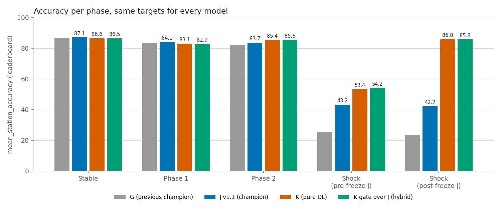
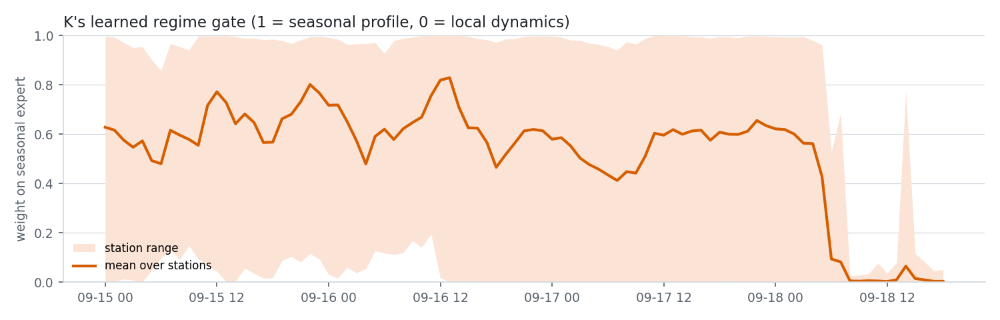
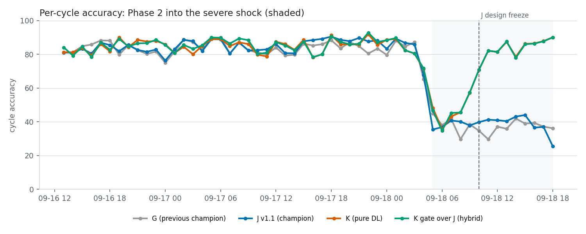
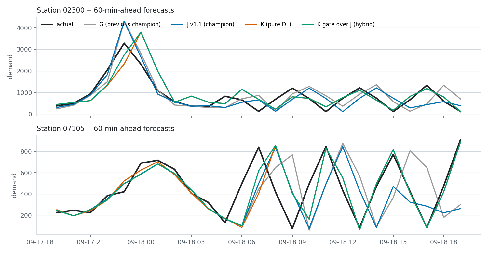

# Candidate K: regime-robust deep forecaster

Generated 2026-10-01T13:29:56.516337+00:00. Research only: nothing here writes to Supabase, submits, or touches Predict or `model_versions`.

## Verdict

- **Primary variant:** `k_staged_re` (K v2.1, pure deep learning). K's design freeze is 2026-09-18T19:00:00+00:00 (virtual time). Only cycles after it are a design-blind test.
- **Pre-registered verdict vs J (current champion): `reject`.** Checks: normal_phases_within_tolerance=FAIL, stations_within_tolerance=FAIL, shock_gain=pass.
- **Delta vs J by phase (pp of `mean_station_accuracy`):** stable -0.51, phase 1 -1.00, phase 2 +1.66, shock (before J freeze) +10.20, shock (after J freeze) +43.77.
  - Worst per-station delta in normal phases: -2.65 pp.
- **Leaderboard metric over pooled windows:**
  - all 332 cycles: K 84.62 vs J 83.23;
  - last 7 days: K 83.03 vs J 80.15;
  - last 24 h: K 80.02 vs J 62.29;
  - normal phases only: K 85.12 vs J 85.59.
- **Recommendation (judgment, separate from the pre-registered rule):** do not promote. If approved, run K in shadow and evaluate it on cycles after its freeze.
  - K roughly doubles J's accuracy in the shock and wins on every pooled window that contains it.
  - It is still 0.5-1 pp below J in stable and phase-1 regimes, which the pre-registered tolerance does not allow.

## Iterations (all reported, none hidden)

- v1: k_gated_aug (primary), k_tide_aug, k_gated_noaug (not run to completion)
- v2: k_staged, designed after v1 results
- v2.1: k_staged_re, gate sees the seasonal expert's realized error; designed after the v2 gate diagnosis
- Each iteration was informed by results on the same evaluation window. That is why K is frozen at v2.1 and the next evidence must come from new cycles.

## What K is

- **K v2.1 (`k_staged_re`) has three networks:**
  1. A *seasonal expert*: a TiDE-style residual MLP over the 12 h history, the 7-day profile, the 4-week baseline, yesterday's value, the calendar and a station embedding. It is trained on real data at every refit.
  2. A *local-dynamics expert*: RevIN plus a residual MLP over the last 8 h.
     - It is pre-trained **only on synthetic series** (sinusoids with random periods between 45 min and 32 h, trends, level shifts and regime switches) and then frozen.
     - It never sees an observation, so there is nothing to leak.
  3. A per-horizon *gate* that mixes the two. It sees regime evidence: recent-vs-profile ratios, volatility, backtests of the local expert over the last 1-4 h, and the realized error of the seasonal expert's own forecasts issued 1 h and 2 h earlier.
     - The gate value is K's regime trace.
- **Scale and loss:** every demand channel is divided by the station's trailing 7-day mean, and the loss is L1 in that space, which approximates the per-station WAPE behind the leaderboard.
- **Gate training:** real samples, plus 35% of samples whose recent tail and targets are replaced by a synthetic regime that starts 4-12 h before the cutoff.
  - The seasonal references stay unchanged, as they would at the start of a real regime change.
  - The v1 variants used a simpler augmentation (level shifts, 1-16 h oscillations, warps, ramps) inside a single end-to-end network.
- **Ensemble:** 3 seeds, median.
- **Walk-forward:** daily at 05:00Z from scratch, targets observed by the refit time. Training uses one origin every 30 min. Every input is <= the cycle `data_cutoff`, and K never trains on a target it is scored on.
- **Comparison rows:** G and J are scored on exactly the same rows.
  - Before the J design freeze, the rows come from the J replay.
  - After the freeze, they are the official production predictions.

## Pooled windows (`mean_station_accuracy`)

| model | all_cycles | last_7d | last_24h | normal_phases |
|---|---|---|---|---|
| G | 81.98 | 77.93 | 50.15 | 85.24 |
| J | 83.23 | 80.15 | 62.29 | 85.59 |
| k_staged_re | 84.62 | 83.03 | 80.02 | 85.12 |
| k_staged | 84.15 | 82.54 | 80.18 | 84.61 |
| k_gated_aug | 83.61 | 81.70 | 64.27 | 85.91 |
| k_tide_aug | 82.38 | 80.10 | 59.06 | 85.14 |
| k_local_zero_shot | 75.68 | 76.26 | 78.30 | 75.62 |
| k_staged_j | 84.16 | 82.58 | 80.47 | 84.60 |
| k_staged_re_j | 84.60 | 82.99 | 80.32 | 85.10 |

## Accuracy per phase (`mean_station_accuracy`, leaderboard metric)

Cycles: stable 168, phase 1 110, phase 2 40, shock (before J freeze) 5, shock (after J freeze) 9.

| model | stable | phase 1 | phase 2 | shock (before J freeze) | shock (after J freeze) |
|---|---|---|---|---|---|
| G | 87.04 | 83.78 | 82.19 | 25.24 | 23.35 |
| J | 87.07 | 84.09 | 83.73 | 43.18 | 42.19 |
| k_staged_re | 86.56 | 83.10 | 85.39 | 53.38 | 85.96 |
| k_staged | 86.08 | 82.25 | 85.13 | 54.12 | 85.84 |
| k_gated_aug | 85.97 | 84.70 | 88.49 | 44.94 | 44.14 |
| k_tide_aug | 85.19 | 83.75 | 87.02 | 40.28 | 33.62 |
| k_local_zero_shot | 74.88 | 74.64 | 79.64 | 54.87 | 86.22 |
| k_staged_j | 86.04 | 82.24 | 85.22 | 54.62 | 86.10 |
| k_staged_re_j | 86.55 | 82.90 | 85.58 | 54.23 | 85.76 |

Global WAPE accuracy:

| model | stable | phase 1 | phase 2 | shock (before J freeze) | shock (after J freeze) |
|---|---|---|---|---|---|
| G | 87.13 | 83.30 | 81.61 | 28.62 | 24.79 |
| J | 87.17 | 83.79 | 83.15 | 41.90 | 41.87 |
| k_staged_re | 86.74 | 82.89 | 84.05 | 59.18 | 85.37 |
| k_staged | 86.38 | 82.17 | 83.75 | 59.60 | 85.50 |
| k_gated_aug | 86.06 | 84.75 | 87.82 | 45.75 | 44.50 |
| k_tide_aug | 85.32 | 83.89 | 87.41 | 38.65 | 34.05 |
| k_local_zero_shot | 75.08 | 75.04 | 79.37 | 60.00 | 85.71 |
| k_staged_j | 86.29 | 82.03 | 83.77 | 59.84 | 85.66 |
| k_staged_re_j | 86.68 | 82.62 | 84.17 | 59.66 | 84.96 |

Relative bias, % (positive means under-forecast):

| model | stable | phase 1 | phase 2 | shock (before J freeze) | shock (after J freeze) |
|---|---|---|---|---|---|
| G | -0.30 | 2.32 | -3.25 | -19.32 | -27.94 |
| J | -0.32 | 1.40 | -3.75 | 8.71 | 9.87 |
| k_staged_re | 1.36 | 3.54 | 3.22 | -2.94 | 0.63 |
| k_staged | 1.30 | 3.17 | 2.40 | -3.69 | 1.06 |
| k_gated_aug | 1.42 | 2.10 | 3.27 | 2.67 | -5.14 |
| k_tide_aug | 1.66 | 2.15 | 3.38 | 1.69 | -9.47 |
| k_local_zero_shot | 1.49 | 1.13 | -1.14 | -5.38 | 1.33 |
| k_staged_j | -0.12 | 0.59 | -0.21 | -4.12 | 1.22 |
| k_staged_re_j | -0.06 | 0.96 | 0.01 | -3.64 | 0.22 |

## Wins and losses per cycle

| vs | phase | win | loss | tie |
|---|---|---|---|---|
| G | shock (after J freeze) | 9 | 0 | 0 |
| G | phase 1 | 32 | 78 | 0 |
| G | phase 2 | 23 | 17 | 0 |
| G | shock (before J freeze) | 4 | 1 | 0 |
| G | stable | 45 | 123 | 0 |
| J | shock (after J freeze) | 9 | 0 | 0 |
| J | phase 1 | 29 | 81 | 0 |
| J | phase 2 | 22 | 18 | 0 |
| J | shock (before J freeze) | 4 | 1 | 0 |
| J | stable | 46 | 122 | 0 |

## Per horizon

| phase | horizon_minutes | G | J | k_staged_re | k_staged_re - J |
|---|---|---|---|---|---|
| stable | 15 | 86.96 | 87.01 | 86.95 | -0.05 |
| stable | 30 | 87.36 | 87.37 | 86.77 | -0.60 |
| stable | 45 | 86.98 | 87.01 | 86.46 | -0.56 |
| stable | 60 | 86.84 | 86.90 | 86.06 | -0.84 |
| phase 1 | 15 | 85.20 | 85.49 | 84.77 | -0.72 |
| phase 1 | 30 | 84.07 | 84.40 | 83.98 | -0.42 |
| phase 1 | 45 | 83.48 | 83.42 | 82.85 | -0.58 |
| phase 1 | 60 | 82.37 | 83.07 | 80.81 | -2.26 |
| phase 2 | 15 | 84.44 | 84.77 | 89.59 | 4.81 |
| phase 2 | 30 | 82.56 | 84.44 | 86.71 | 2.27 |
| phase 2 | 45 | 82.27 | 83.81 | 84.01 | 0.19 |
| phase 2 | 60 | 79.38 | 81.82 | 81.12 | -0.71 |
| shock (before J freeze) | 15 | 44.81 | 71.39 | 78.85 | 7.46 |
| shock (before J freeze) | 30 | 29.66 | 53.24 | 63.32 | 10.09 |
| shock (before J freeze) | 45 | 19.98 | 31.84 | 43.82 | 11.98 |
| shock (before J freeze) | 60 | 16.16 | 16.51 | 28.67 | 12.16 |
| shock (after J freeze) | 15 | 38.96 | 61.80 | 88.39 | 26.60 |
| shock (after J freeze) | 30 | 32.60 | 50.94 | 86.30 | 35.37 |
| shock (after J freeze) | 45 | 19.27 | 34.58 | 84.75 | 50.17 |
| shock (after J freeze) | 60 | 7.29 | 21.25 | 84.52 | 63.27 |

## Stations

Largest per-station losses vs J in the normal phases:

| phase | station_id | J | k_staged_re | delta |
|---|---|---|---|---|
| phase1 | 05000 | 80.08 | 77.42 | -2.65 |
| phase1 | 05100 | 84.65 | 82.29 | -2.36 |
| phase1 | 02300 | 87.05 | 84.91 | -2.14 |
| phase2 | 09122 | 88.21 | 86.09 | -2.12 |
| stable | 09122 | 87.49 | 85.68 | -1.81 |

Shock after the J freeze, per station:

| station_id | G | J | k_staged_re | delta |
|---|---|---|---|---|
| 02300 | 27.42 | 39.91 | 85.68 | 45.77 |
| 03000 | 7.95 | 56.31 | 85.52 | 29.21 |
| 05000 | 36.02 | 49.08 | 89.73 | 40.65 |
| 05100 | 0.00 | 45.00 | 86.01 | 41.01 |
| 06000 | 20.87 | 42.25 | 80.65 | 38.40 |
| 06111 | 26.39 | 32.63 | 87.89 | 55.26 |
| 07105 | 28.91 | 48.13 | 89.17 | 41.04 |
| 07107 | 39.00 | 23.85 | 83.55 | 59.70 |
| 07111 | 20.71 | 36.35 | 84.08 | 47.73 |
| 09000 | 13.82 | 43.02 | 86.91 | 43.89 |
| 09122 | 29.63 | 48.18 | 86.98 | 38.80 |
| 10009 | 29.50 | 41.60 | 85.40 | 43.80 |

## Caveats (read before acting)

1. **Not design-blind for K.** The architecture and the augmentation were chosen after the shock was inspected up to the latest observation, which shows a near-periodic oscillation of about 4 h.
   - The post-freeze shock cycles are walk-forward for K, with no training leakage. They are not a design-blind test.
   - The only clean test is cycles after K's own design freeze.
2. **Few shock cycles:** 5 before the J freeze and 9 after it. There is no recovery yet, so the 12-hour and recovery requirements of the J protocol are not met for K either.
3. **No production path yet.** K needs PyTorch, which is not a dependency of Predict or the shadow workflows. Deploying it in shadow needs either a CPU torch install in a separate workflow, or a numpy forward pass over exported weights. Both need explicit approval.

## Reproduce

```bash
python scripts/candidate_k_experiment.py --variants k_staged_re,k_staged,k_gated_aug,k_tide_aug --seeds 3
python scripts/candidate_k_figures.py && python scripts/candidate_k_report.py
```

Snapshot: `data/interim/candidate_k/snapshot/manifest.json` (Supabase read-only GET, sha256 per table).

## Figures





